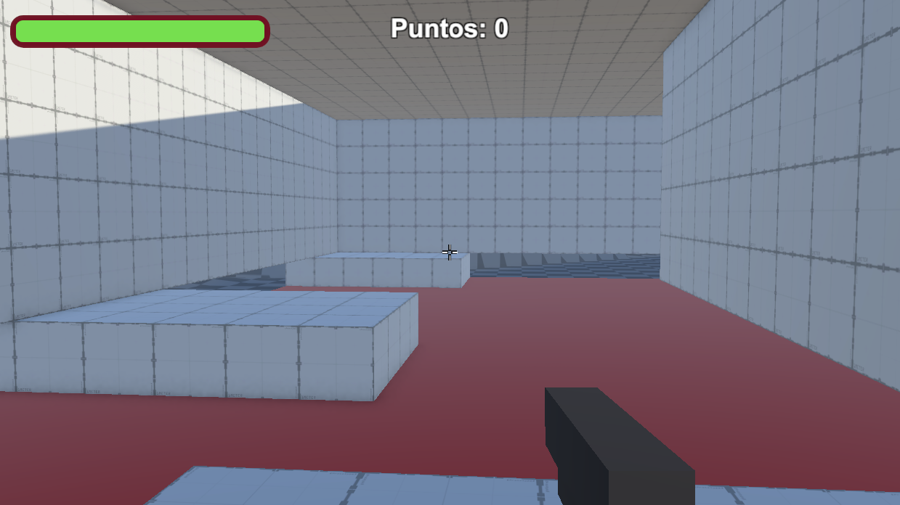
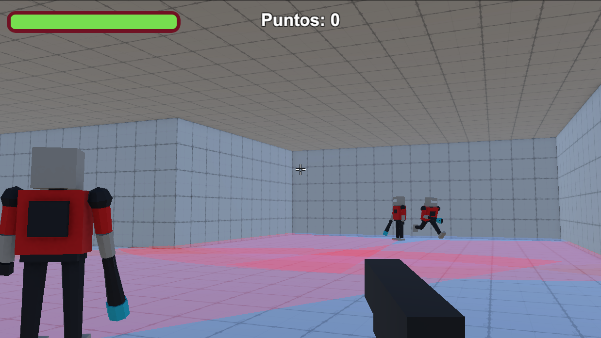
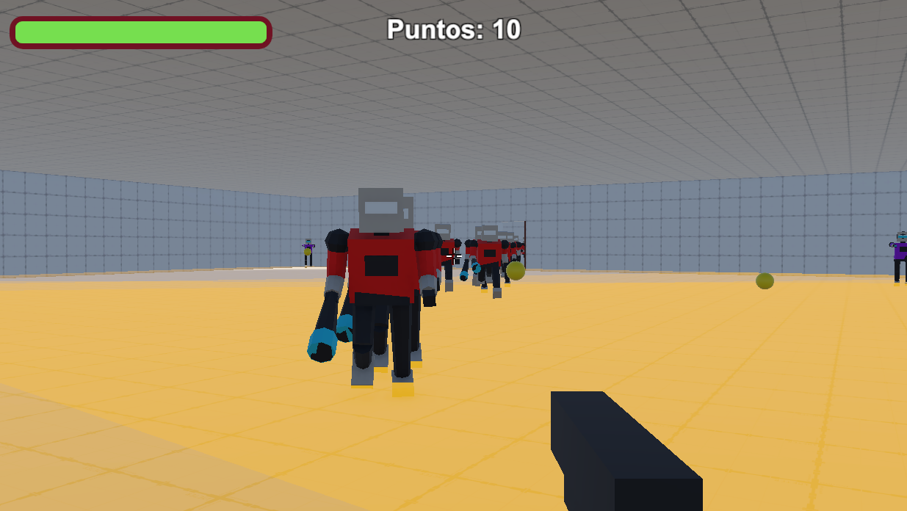
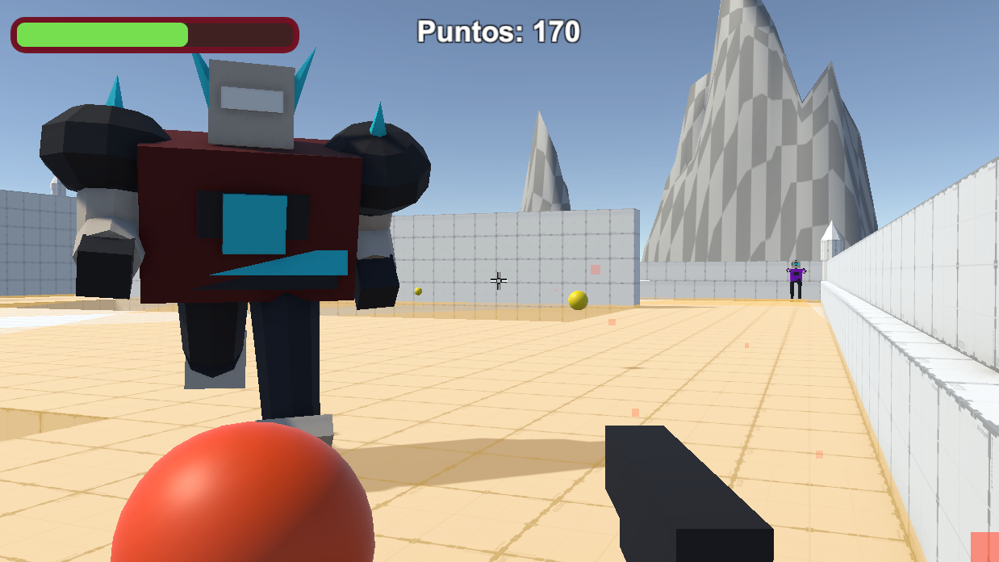

#  Juego: Subject 01 - SteamAOS

**Asignatura:** Programación de Videojuegos I 

**Carrera:** Tecnicatura Universitaria en Diseño Integral de Videojuegos (TUDIVJ) — UNJu 

**Trabajo Final Integrador** 

**Estudiantes:** Mateo Ricardo Carrizo y Estaban Josué Farfan.

**LU:** TUV000877 y TUV000823.

**Equipo Docente:** Mg. Ing. Ariel Alejandro Vega | Tecn. Kevin Alexis Roman Llampa 
--- 
## 🎮 Descripción del Proyecto  

<!-- 
Párrafo breve (3 a 5 líneas) explicando de qué trata tu nivel de juego.
Ejemplo: "En este proyecto el jugador debe recorrer un circuito de plataformas en espacio abierto, esquivando trampas temporizadas y generadores de obstáculos. El objetivo final es encontrar el objeto clave, transportarlo hasta la zona de Meta y activar el pedestal de victoria."
-->
Al "Sujeto 01" se le es encomendada una misión de eliminación, ¿el objetivo? Lord Mayus, jefe de la orden Altus. 

Shooter en primera persona con enfoque de alta velocidad. 

Consignas opcionales: Sitema de Sigilo e Infiltración, al agacharse los enemigos tienen rango de vision reducido.

Selector de Dificultad en Menú Principal: Al darle al boton jugar se puede elegir un nivel de dificultad que cambia los daños, vida y velocidad de los enemigos. (Facil, Normal, Dificil).

--- 

## 🕹️ Controles del Jugador 
| Acción | Tecla / Botón | Descripción | 
| :--- | :--- | :--- | 
| **Movimiento** | `W`, `A`, `S`, `D` | Mover al personaje por el escenario | 
| **Salto** | `Espacio` | Saltar entre plataformas | 
| **Interactuar** | `E` | Abrir y cerrar puertas |
| **Disparar** | `Click Izquierdo` | Dispara el arma |
| **Dashear** | `Ctrl Izquierdo` | Dash hacia adelante |
| **Agacharse** | `C` | Se agacha cerca del suelo |
| **Pause** | `P` | Menú de Pausa |
| **Correr** | `Shift Izquierdo` | Corre a gran velocidad |

--- 
## 📸 Capturas de Pantalla  

<!-- 
Inserta 1 o 2 imágenes o GIFs animados del juego en ejecución.
Puedes colocar la imagen dentro de tu carpeta del proyecto (ej: Assets/Documentation/demo.gif)
o subirla a GitHub y pegar la ruta aquí.
--> 




 

 

--- 

 ## 📝 Roles y Ramas del Repositorio:

**Rol Lider de Repo:** Carrizo Mateo Ricardo
**Rama:** carrizoMateo

**Rol Segundo al Mando:** Esteban Josué Farfan
**Rama:** ia-enemigos

--- 

## 📝 Explicación Técnica de Codigo: 
<!-- Explica los scripts  detallando su nombre, el funcionamiento brevemente y un fragmento qque destaque o resalte del script -->  

### 1. Jugador (`Movimiento`)

* **Script principal:** `FirstPersonController.cs` 
* **Funcionamiento:** Se utilizó el package de Unity de FPC para darle control de movimiento al jugador y camara.
```csharp 
// Fragmento destacado del script: 
		private void Start()
		{
			_controller = GetComponent<CharacterController>();
			_input = GetComponent<StarterAssetsInputs>();
#if ENABLE_INPUT_SYSTEM
			_playerInput = GetComponent<PlayerInput>();
#else
			Debug.LogError( "Starter Assets package is missing dependencies. Please use Tools/Starter Assets/Reinstall Dependencies to fix it");
#endif

			// reset our timeouts on start
			_jumpTimeoutDelta = JumpTimeout;
			_fallTimeoutDelta = FallTimeout;
		}
```

### 2. Enemigos (`IA`)
* **Script principal:** `EnemyMelee.cs` 
* **Funcionamiento:** Component NavMeshAgent, Rigidbody para el movimiento y colisiones.
```csharp 
    void Awake()
    {
        agent = GetComponent<NavMeshAgent>();
        Rigidbody rb = GetComponent<Rigidbody>();
        if (rb != null)
        {
            rb.isKinematic = true;
            rb.useGravity = false;
        }
    }
```

### 3. UIManager (`Manager del UI`)
* **Script principal:** `UIManager.cs` 
* **Funcionamiento:** Maneja los playerPrefs, StateChanges y Funciones de apertura de Canvas.
```csharp 
    private void Start()
    {
        Subscribe();
        float volume = PlayerPrefs.GetFloat("MasterVolume", 1f);
        mainMixer.SetFloat("MasterVolume", Mathf.Log10(Mathf.Max(volume, 0.0001f)) * 20);

        if (volumeSlider != null)
            volumeSlider.value = volume;

        if (GameManager.Instance != null)
            StateChage(GameManager.Instance.CurrentState);
    }
```
